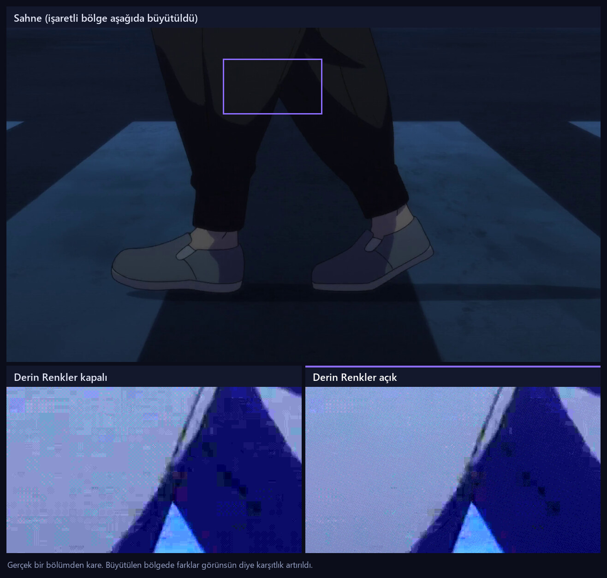

FRC sitede "Derin Renkler" adıyla geçiyor. Koyu sahnelerde, gece gökyüzünde ya da yumuşak geçişli arka planlarda renkler bazen basamak basamak görünür, buna bantlanma deniyor. Derin Renkler bu basamakları azaltıp geçişleri daha düzgün gösteriyor. İzleme sayfasındaki ayarlardan açılıyor ve yoğunluğu %10 ile %100 arasında ayarlanabiliyor.

## Başlangıç

Anime yayınları 8 bit geliyor ve sıkıştırılıyor. Bu yüzden karanlık sahnelerde ve gökyüzünde tonlar düzgün akmak yerine basamak basamak ilerliyor. İncelediğimiz diğer FRC çözümleri bu basamaklara hiç dokunmuyor, sabit bir desenle titreşim ekliyordu ve bir ayarları yoktu. Kullandıkları iki durumlu desen 24 fps bir animede saniyede 12 kez gidip gelen hafif bir titreme oluşturuyordu.

## Geliştirme

İlk adım oynatıcının içini 10 bite çıkarmaktı. Böylece videonun renk dönüşümünden, büyütmeden ve ara kare üretiminden gelen ince tonlar ekrana ulaşmadan kaybolmuyor. Görüntü ekrana çizilirken bu tonları, pikselleri iki komşu seviye arasında hafifçe oynatarak koruyoruz. Desen her karede kayıyor ve 64 karede başa dönüyor, o 12 Hz'lik titreme de böylece ortadan kalktı.

Burada bir kez geri adım attık. İlk denediğimiz titreşim türü tam siyah bantlarda piksellerin yaklaşık sekizde birini griye çıkarıyordu. Onu bırakıp tam siyaha ve tam beyaza hiç dokunmayan bir yönteme geçtik.

Bantlanmayı azaltan kısım ayrı bir adım. Her pikselin çevresine bakıp tonu ona çok yakın olan komşularla yumuşatıyoruz. Yakında bir çizgi ya da keskin kenar varsa o bölgeye hiç dokunmuyoruz ve bir pikselin değişebileceği miktarı bir buçuk tonun altında tuttuk. Çizgilerin ve yazıların bozulmaması bu sınır sayesinde.

## Sonuç

Bu kare gerçek bir bölümden. Koyu sahnedeki düz alanda, Derin Renkler kapalıyken sıkıştırmadan gelen bloklar ve basamaklar görünüyor; açıkken yumuşuyor, kıyafetin kenar çizgisi ise olduğu gibi kalıyor.

8 bite yuvarlanmış yapay bir geçişte, ideal geçişe olan uzaklık 0,288 tondan 0,123 tona indi. Gerçek 1080p karelerde düz alanlardaki bant kenarları %60-66 azaldı, 1 piksellik ince çizgilerde ise hiçbir değişiklik olmadı. Birbirinden çeyrek ton farklı dört renk, Derin Renkler kapalıyken ekranda üçü aynı renge dönüşüyor; açıkken dördü de ayrı ayrı korunuyor. FPS Artırma ve 4K ile birlikte 20 dakikalık kesintisiz bir oynatmada 240 binden fazla kare hatasız çizildi.

Bir sınırı var: film greni ya da ince sis gibi çok hafif bir doku varsa biraz yumuşayabiliyor.

Kod bu depoda yok, Deokwave kapalı kaynak.

[deokwave.com](https://deokwave.com) · [Discord](https://discord.gg/deokwave) · [Deokwave GitHub](https://github.com/Deokwave)
